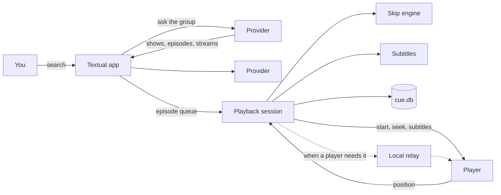

The big picture: what happens between typing a search and an episode playing.

## The app

Cue is a [Textual](https://textual.textualize.io) app: one full-screen program made of
screens.

| Screen | What it does |
|---|---|
| Home | The search box, Continue Watching, setup hints |
| Results | Matches from every provider in the group, ranked as they arrive |
| Episodes | The episode grid, a range box, SUB/DUB, download and cast |
| Now Playing | What's playing, skip and subtitle status, playback keys |
| Plugins | Providers, groups, players and plugins |

Everything runs on one asyncio event loop: searches, provider requests, the player
connection, skip lookups and database writes. The local relay and the cast server serve
HTTP on their own threads and hand provider work back to that loop.

## Providers

A provider answers three questions, as described in
[Writing a Plugin](Writing-a-Plugin#a-provider):

1. `search(query)`: the shows and movies matching a title.
2. `episodes(show)`: a show's episodes.
3. `stream(episode)`: the ways to play one: URLs with the headers and subtitles each needs.

Providers come from three places: built in (Jellyfin, Local), [plugins](Plugins), and older
single-file modules. Each says which [search groups](Search-Groups) it's in. A search asks
every provider in the group at once and ranks the results against the query with
[RapidFuzz](https://github.com/rapidfuzz/RapidFuzz) as they arrive.

From a provider's streams, Cue picks one by your `quality` setting.

## The playback session

Pressing `Enter` on an episode starts a **playback session** for a queue of episodes (one,
a range, or everything from there on). For each episode, the session:

1. asks the provider for streams and picks one;
2. starts a **fresh player process** at the saved resume point (anything under 5 seconds
   counts as the start);
3. loads subtitles (see [Subtitles](Subtitles));
4. asks the skip engine for the episode's opening and ending;
5. follows the player's position:
   - skips an opening or ending as the position enters it,
   - writes the position to the database every 5 seconds of playback, and on exit,
   - marks the episode watched once 90% of it has played;
6. when the player reports the end, moves to the next episode if `auto_next` is on.

Your keys (`n`, `p`, `r`, `s`, `c`) go into the same session, so a key press and the end
of an episode can't both act.

## Players

A player is anything implementing Cue's `Player` interface: start a URL at a position,
report position and length, seek, add a subtitle, stop. Each player also declares what it
can handle. That's how Cue decides whether to step in with the
[local relay](Playback-and-the-Local-Relay).

- **VLC** is started with its local web interface on `127.0.0.1` and a fresh random
  password. Cue reads its position and length about four times a second and sends seeks
  and subtitle commands. A small status page shipped with Cue (loaded with
  `--http-src`) uses VLC's Lua subtitle API, so Cue can select the subtitle it loaded.
  No VLC files or preferences are changed.
- **mpv** is driven over its JSON IPC: a named pipe on Windows, a Unix socket elsewhere.
  Cue watches its properties as they change. Each episode starts with `--keep-open=yes`,
  so mpv reports the end, and `--start` to resume.
- **Programs Cue can't control** (ffplay, the Default app, Another program) are started
  with the right command line, and the session waits for them to close.

## Skipping

The skip engine turns a show into a MyAnimeList ID, then asks AniSkip for the episode's
skip times; both answers are cached. [Skipping](Skipping) has the details.

## Storage

`cue.db` is a SQLite database with five tables:

| Table | Holds |
|---|---|
| `history` | Each show's last episode and position: Continue Watching and resume points |
| `watched` | Every episode watched to the end |
| `mal_ids` | Shows matched to MyAnimeList IDs |
| `skip_times` | AniSkip's answers |
| `subtitles` | Which subtitle file each episode uses, and where it came from |

## Settings

`config.toml` is read when Cue starts. Changes from the Plugins menu go through
[tomlkit](https://github.com/python-poetry/tomlkit), so your comments and layout survive,
and they're saved only if the result is still a valid config. A changed provider is
restarted on its own; the others keep running.

## Where to go next

- [Playback and the Local Relay](Playback-and-the-Local-Relay): how any stream reaches any
  player, and how downloads stay fast and small.
- [How Casting Works](How-Casting-Works): the media server, AirPlay and Chromecast.
- [How Plugins and Updates Work](How-Plugins-and-Updates-Work): installing and replacing
  code safely.
- [Development](Development): where each part lives in the code.
